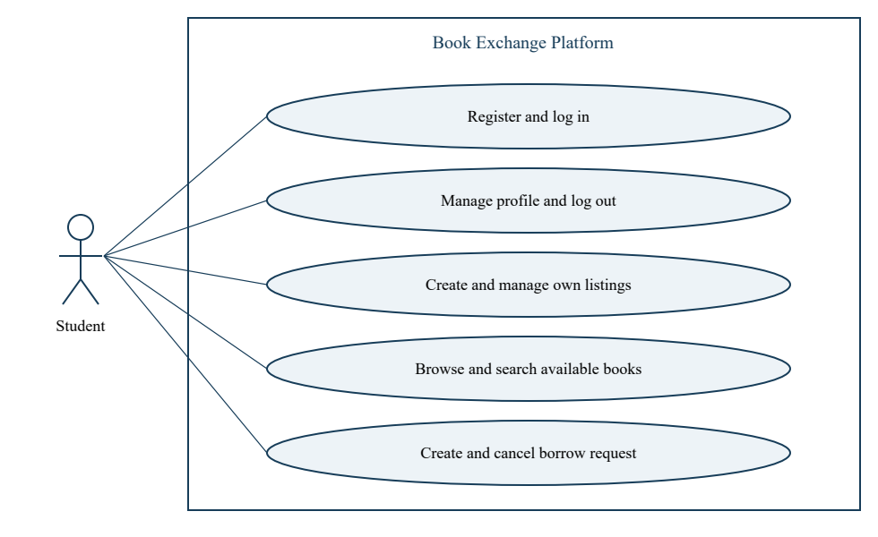
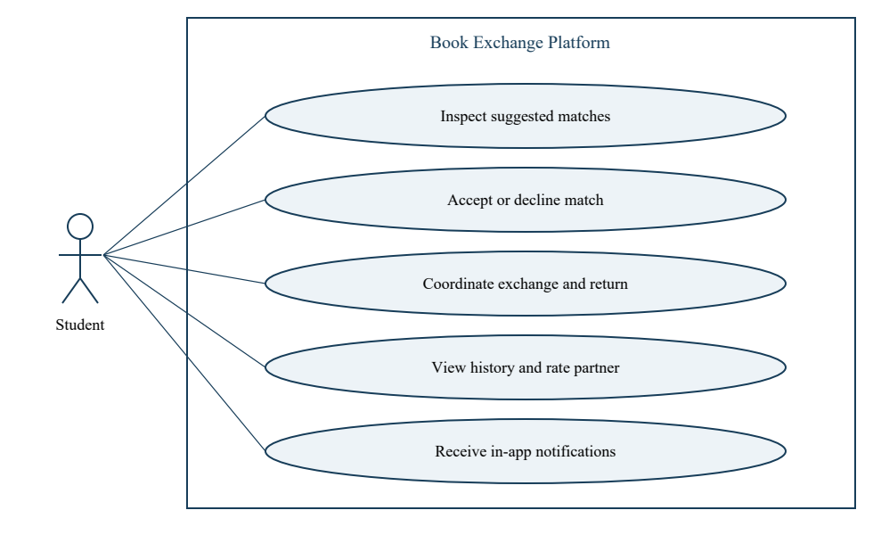
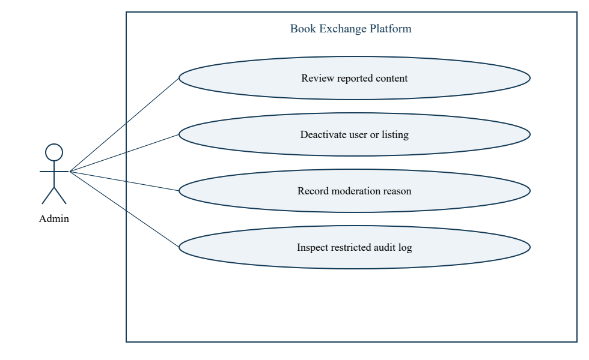

# Book Exchange Platform

## Software Requirements Specification

This specification defines the student book lending and borrowing platform, its release scope, measurable acceptance criteria and traceability. Sprint 1 delivers authentication and listings; Sprint 2 adds matching and exchanges. The platform coordinates physical handover rather than processing payments or shipping books.

Version 1.0 | 27 October 2026

Status: Submission baseline; implementation and test execution pending.

Authors: Nishkal - DevOps and coordination; Abhiram - Auth; Manoj - Listings; Ravish - UI, documentation and demo.

Approval: Team and TA review pending.

### Contents

1 Introduction; 2 Overall description; 3 External interfaces; 4 System features; 5 Non-functional and security requirements; 6 Acceptance; 7 Use-case models; 8 Requirements traceability.

## 1 Introduction

### 1.1 Purpose and audience

Provide a shared implementation and verification contract for students, developers, testers and the course evaluator. Requirement IDs are stable references for Jira, pull requests, design sections and tests.

### 1.2 Scope

Registered students lend their own books, discover available listings, request books, receive ranked matches, accept an exchange, coordinate handover and confirm return. Admins moderate users and listings. Payments, delivery, automatic fines, identity-document collection, email/SMS delivery and university SSO are outside this release.

### 1.3 Definitions

| Term | Meaning |
| --- | --- |
| SRS / SAD / STP | Requirements / Architecture and Design / Software Test Plan |
| RTM | Requirements Traceability Matrix |
| JWT | Signed access token; contains no password or private profile data |
| Listing / request / exchange | Offer to lend / intent to borrow / mutually accepted transaction |
| N / A / F / B | Not run / accepted after tests pass / failed / blocked |

## 2 Overall description

### 2.1 Product perspective

A responsive React web app calls a FastAPI JSON API backed by PostgreSQL. Authentication, search, matching, exchanges and moderation share one relational database and are implemented as modules in one backend. The one team GitHub repository contains source, tests and all three deliverables.

### 2.2 Roles

| Role | Capabilities |
| --- | --- |
| Guest | Register, log in, browse and search public listings. |
| Student | Manage own profile/listings/requests, accept matches, coordinate exchanges, view own history and rate partners. |
| Admin | Student capabilities plus moderation and restricted audit review; no public admin registration. |

### 2.3 Operating environment and constraints

Development baseline: Python 3.11, Node 20, PostgreSQL 15 with pg_trgm, Docker Compose and a modern browser. The plan specifies FastAPI, React/Vite, SQLAlchemy, Alembic and GitHub Actions. Pin dependency versions during scaffold implementation. Use HTTPS hosting with a persistent database. Record any hosting limits and cold starts in the test evidence.

### 2.4 Planning decisions and dependencies

University email domains must be supplied before registration acceptance testing; use configurable ALLOWED_EMAIL_DOMAINS, never invent the institution domain. NF-002 and NF-005 thresholds are team-proposed measurable baselines because the plan names these requirements without numerical values. Matching scoring and Sprint 2 transition details below are proposed implementation contracts to review on 2 November. Dates follow the TA announcement rather than alternate illustrations.

Account ownership is separate from work assignment: the established GitHub repository remains Nishkal00/Book-Exchange-Platform. Final roles are Nishkal on DevOps, Abhiram on Auth, Manoj on Listings, and Ravish on UI/docs/demo, overriding the role labels in the supplied PDF.

## 3 External interface requirements

### 3.1 User interfaces

Pages: Register, Login, Browse/Search, My Listings, Profile, Requests/Matches, Exchanges/History and Admin. Show loading, empty, validation and server-error states. Keep labels visible; support keyboard navigation. Hide owner controls for other students while still enforcing authorization on the server. A 401 clears the session; a login 401 displays credential feedback instead of a redirect loop. A 429 displays retry guidance.

### 3.2 Software and hardware interfaces

No special hardware is required beyond a browser-capable device and network. The frontend consumes /api/v1 JSON endpoints; /health is a deployment probe. PostgreSQL stores relational entities. GitHub Actions runs build/test/deployment jobs; Jira tracks work. No payment or external book-catalog API is required.

### 3.3 Communication and data contracts

Use UTF-8 JSON, ISO-8601 UTC timestamps and Authorization: Bearer tokens. Validate input and return a consistent error object {error: {code, message}}; validation errors may additionally include a fields list. Cross-origin requests are restricted to the configured frontend. Password hashes, JWT secrets, token_version and private contact data never appear in public listing responses.

## 4 System features

### 4.1 Authentication and profile

### F-001 Register

The system shall register students using an allowed university email domain. Lowercase email; name 1-100 characters; password at least 8 characters with a letter and digit. Valid input returns 201; duplicate email 409; other domains 400; invalid fields 422. New users have the student role.

Priority: High | Module: Auth | Sprint 1 | Verification: TC-AUTH-01, TC-AUTH-02, TC-SEC-01

### F-002 Login

The system shall authenticate email and password and issue a 30-minute JWT. Valid credentials return 200 with token and expiresIn=1800. Unknown email and wrong password both return the same 401 INVALID_CREDENTIALS.

Priority: High | Module: Auth | Sprint 1 | Verification: TC-AUTH-03, TC-AUTH-04, TC-SEC-02

### F-003 Logout and expiry

The system shall invalidate all existing tokens for the current user by atomically incrementing token_version on logout (204). Expired, tampered or version-mismatched tokens shall return 401 on protected endpoints.

Priority: High | Module: Auth | Sprint 1 | Verification: TC-AUTH-05, TC-AUTH-06

### F-004 Profile

The system shall allow an authenticated student to view and edit name, department and location. Saved changes appear in the next GET. Email, role, active and password_hash cannot be changed via this endpoint.

Priority: High | Module: Auth | Sprint 1 | Verification: TC-PRF-01, TC-PRF-02

## 4.2 Listings

### F-010 Create listing

The system shall create a listing for its authenticated owner, reuse a book by normalized unique ISBN, and set status AVAILABLE. Require title 1-200, author 1-150, location 1-100 and condition NEW/GOOD/FAIR/POOR. ISBN is 10 or 13 digits after hyphen removal in this course baseline. Valid input returns 201; invalid fields 422.

Priority: High | Module: Listings | Sprint 1 | Verification: TC-LST-01, TC-LST-02, TC-SEC-04

### F-011 Search and own listings

The system shall publicly search AVAILABLE, non-deleted listings by title/author q, ISBN and location with pagination. Defaults page=1,size=20; size above 100 or page below 1 returns 422. Unknown searches return an empty items list. Authenticated /listings/mine returns only the caller's non-deleted listings including unavailable ones.

Priority: High | Module: Listings | Sprint 1 | Verification: TC-LST-03, TC-LST-04, TC-LST-08

### F-012 Update listing

The system shall allow the owner to partially update a listing, including AVAILABLE/UNAVAILABLE status. Non-owners receive 403; missing/deleted IDs 404. Reserved or on-loan listings cannot be changed to available or have their book changed.

Priority: High | Module: Listings | Sprint 1 | Verification: TC-LST-05, TC-SEC-05

### F-013 Delete listing

The system shall soft-delete owner listings and return 204. Non-owners receive 403. A listing involved in an active exchange cannot be deleted (409 ACTIVE_EXCHANGE). Deleted listings are excluded from public and own-listing queries.

Priority: High | Module: Listings | Sprint 1 | Verification: TC-LST-06, TC-LST-07, TC-SEC-05

## 4.3 Requests and matching

### F-020 Borrow request

The system shall let an authenticated student create an OPEN borrow request specifying ISBN or a nonempty title query and location. Invalid input returns 422; duplicate active requests by the same student and criteria return 409.

Priority: High | Module: Requests & Matching | Sprint 2 | Verification: TC-REQ-01

### F-021 Cancel request

The system shall allow only the borrower to cancel an OPEN or MATCHED request. Cancel linked pending matches and release any uncommitted reservation atomically. An accepted exchange must use its exchange cancellation transition; non-owner requests return 403.

Priority: High | Module: Requests & Matching | Sprint 2 | Verification: TC-REQ-02

### F-022 Match requests

The system shall rank available non-deleted listings from other active users using ISBN or title relevance, location and condition. Return at most five deterministic suggestions. Recompute after decline, cancellation or listing changes; never reserve one listing for two active exchanges.

Priority: High | Module: Requests & Matching | Sprint 2 | Verification: TC-MAT-01, TC-MAT-02, TC-MAT-03

### F-023 Notifications

The system shall create durable in-app notifications for new matches, partner decisions and exchange changes. Users can view and mark only their own notifications as read. Reprocessing the same event shall not duplicate notifications.

Priority: High | Module: Exchange | Sprint 2 | Verification: TC-NOT-01

### F-024 Match decision

The system shall allow each participant to accept or decline a proposed match. Only mutual acceptance creates an exchange and permits contact disclosure. A stale or conflicting decision returns 409 and cannot create a second active exchange.

Priority: High | Module: Requests & Matching | Sprint 2 | Verification: TC-MAT-04, TC-SEC-07

## 4.4 Exchanges and moderation

### F-025 Exchange lifecycle

The system shall record an agreed future due date for an ACCEPTED exchange and move it to ON_LOAN when the lender confirms handover. Either participant may cancel before handover; cancellation after handover is rejected. Transitions require participant authorization and retain history.

Priority: High | Module: Exchange | Sprint 2 | Verification: TC-EXC-01

### F-026 Confirm return

The system shall record each participant's return confirmation. Only both confirmations move ON_LOAN to RETURNED and restore listing availability. Repeated confirmations are idempotent.

Priority: High | Module: Exchange | Sprint 2 | Verification: TC-EXC-02

### F-030 Exchange history

The system shall return paginated past and current exchanges only to their participants, including book, dates, partner display name and state. Other students cannot read the exchange.

Priority: High | Module: Exchange | Sprint 2 | Verification: TC-HIS-01

### F-031 Ratings

The system shall permit each participant to rate their partner once per RETURNED exchange using an integer 1-5. Reject self-rating, pre-return ratings and duplicates. Recompute the recipient average from accepted ratings.

Priority: High | Module: Exchange | Sprint 2 | Verification: TC-RAT-01

### F-040 Moderation and audit

The system shall allow admins to deactivate abusive users and hide listings with a required reason, recording actor, target, action and time. Student access returns 403. Inactive users cannot authenticate or use existing tokens. Audit records are not editable through public APIs.

Priority: High | Module: Admin | Sprint 2 | Verification: TC-ADM-01, TC-ADM-02

## 5 Non-functional requirements

### NF-001 Search performance

The search API shall achieve p90 response time <=2 seconds with 50 concurrent users over a 1-minute run, ramping at 10 users/second, using 10,000 listings and about 2,000 books. Report errors, host resources and cold-start exclusions; do not claim success from an unrepresentative sample.

Priority: High | Module: Listings | Sprint 1 | Verification: TC-PERF-01

### NF-002 Availability

The deployed demo shall target >=99% successful /health probes during 2-7 November, measured every five minutes. Count sleep and unexpected outages as failures; disclose planned maintenance and missing measurements. This short-window target is not a monthly SLA.

Priority: High | Module: DevOps | Sprint 2 | Verification: TC-OPS-01

### NF-003 Usability

The UI shall work at 360px width without horizontal scrolling. From the authenticated Browse page, entering the listing flow and submitting it, and entering a query and displaying results, shall each require <=5 clicks; typing and tabbing are not clicks. Inputs have labels and errors are readable.

Priority: High | Module: UI | Sprint 1 | Verification: TC-UX-01

### NF-004 Quality pipeline

Each main-branch PR shall run lint, backend tests with >=70% application coverage, frontend production build and Docker build. Required checks and one independent approval gate merging. Auth coverage shall exceed 85% by the end of Sprint 1. Deployment runs only after successful main builds.

Priority: High | Module: DevOps | Sprint 1 | Verification: TC-CI-01

### NF-005 Matching performance

The matching engine shall produce the top five candidates at p95 <=2 seconds for 1,000 open requests against 10,000 listings, measured across at least 100 evaluations with 10 concurrent callers on a documented test host. Correctness and race tests remain mandatory.

Priority: High | Module: Requests & Matching | Sprint 2 | Verification: TC-PERF-02

### NF-006 Portability

A fresh checkout with documented environment values shall start backend, frontend and Postgres using docker compose up --build, apply migrations and pass registration/login/listing smoke tests without manual database edits.

Priority: High | Module: DevOps | Sprint 1 | Verification: TC-PORT-01

## 5.1 Security

### 5.1.1 Security objectives

SO-01: Protect credentials, sessions and contact privacy from unauthorized disclosure. Implement SR-001, SR-002, SR-003 and SR-007. SO-02: Preserve ownership and exchange integrity against unauthorized updates, injection and abusive login attempts. Implement SR-004, SR-005 and SR-006.

### 5.1.2 Security requirements

### SR-001 Password protection

The system shall store only salted bcrypt hashes and never return or log passwords or hashes. Reject passwords over 72 UTF-8 bytes to avoid bcrypt truncation. Public response schemas exclude secrets.

Priority: High | Module: Auth | Sprint 1 | Verification: TC-SEC-01

### SR-002 Token validation

Protected routes shall verify JWT signature using an explicit HS256 allowlist, exp, subject, current active user and token_version. Tokens expire after 30 minutes; missing/invalid/expired tokens return 401. JWT_SECRET is supplied outside source control.

Priority: High | Module: Auth | Sprint 1 | Verification: TC-SEC-02, TC-AUTH-05, TC-AUTH-06

### SR-003 Transport protection

Deployed browser/API traffic shall use HTTPS and valid certificates; HTTP redirects to HTTPS without transmitting credentials. Verify TLS 1.2 or later. Restrict CORS to the configured frontend and keep secrets out of the repository.

Priority: High | Module: DevOps | Sprint 2 | Verification: TC-SEC-03

### SR-004 Input and query safety

The system shall validate request fields server-side and use ORM or bound SQL parameters. SQL-looking input must not alter query structure or expose unrelated rows; HTML content is rendered as text.

Priority: High | Module: Listings | Sprint 1 | Verification: TC-SEC-04

### SR-005 Authorization

Every mutation shall enforce ownership or an explicit admin role server-side. Reject non-owner listing edits/deletes with 403 and profile privilege escalation with 422. Return only public fields in listing views.

Priority: High | Module: Listings | Sprint 1 | Verification: TC-SEC-05, TC-PRF-02

### SR-006 Login throttling

After five failed logins for the normalized email/client IP pair in 15 minutes, the next attempt returns 429 and Retry-After, including a correct password. Successful login before the limit clears failures. Expired failures are removed.

Priority: High | Module: Auth | Sprint 1 | Verification: TC-SEC-06

### SR-007 Contact privacy

Email and other contact details shall remain hidden from other students until a specific match is mutually accepted. Only that exchange's participants may retrieve its contact data; cancelled exchanges lose contact access.

Priority: High | Module: Admin | Sprint 2 | Verification: TC-SEC-07

## 6 Quality attributes and acceptance

Accept a story only after its criteria are implemented, tests pass in CI, another teammate reviews the PR, the change is merged and Jira is updated. Tests belong to their feature stories; avoid counting their effort twice. For acceptance, all in-scope high-priority requirements must pass, no critical/high defects may remain, and the RTM must link to actual evidence.

Sprint 1 acceptance includes F-001..F-004, F-010..F-013, NF-001/003/004/006 and SR-001/002/004/005/006. Deploy HTTPS in Sprint 1, then collect formal SR-003 and NF-002 evidence in Sprint 2. The active-exchange delete guard is exercised with a test double in Sprint 1 because the exchange table arrives in Sprint 2; that test does not establish end-to-end exchange integrity. Sprint 2 must replace the stub and rerun the integration case.

Final acceptance includes all listed requirements, the matching race tests, contact privacy, deployment evidence and a complete demonstration. Failures remain F or B until retested. All initial RTM statuses are N; a submitted plan is not proof of completed implementation.

## 7 System models and diagrams

Figure 1. Student account, listing and request use cases. Guests may browse and register; all mutations require login.

Figure 2. Exchange participant use cases. Each association requires participant authorization.

## 7.1 Administrative use cases

Figure 3. Admin-only moderation and audit use cases.

Use-case preconditions and outcomes are specified in section 4. Failed authorization leaves domain data unchanged. Exchange contact access requires mutual acceptance, not merely a match suggestion.

## 8 Requirements Traceability Matrix

N = not run; A = accepted after all linked tests pass; F = failed; B = blocked. Store commit, CI run and evidence paths when replacing N. A requirement with multiple tests is accepted only when every applicable test passes. Design references are SAD sections 3 and 4.3 unless otherwise noted.

| Req | Design module | Test IDs | Sprint | Status |
| --- | --- | --- | --- | --- |
| F-001 | Auth | TC-AUTH-01, TC-AUTH-02, TC-SEC-01 | 1 | N |
| F-002 | Auth | TC-AUTH-03, TC-AUTH-04, TC-SEC-02 | 1 | N |
| F-003 | Auth | TC-AUTH-05, TC-AUTH-06 | 1 | N |
| F-004 | Auth | TC-PRF-01, TC-PRF-02 | 1 | N |
| F-010 | Listings | TC-LST-01, TC-LST-02, TC-SEC-04 | 1 | N |
| F-011 | Listings | TC-LST-03, TC-LST-04, TC-LST-08 | 1 | N |
| F-012 | Listings | TC-LST-05, TC-SEC-05 | 1 | N |
| F-013 | Listings | TC-LST-06, TC-LST-07, TC-SEC-05 | 1 | N |
| F-020 | Requests & Matching | TC-REQ-01 | 2 | N |
| F-021 | Requests & Matching | TC-REQ-02 | 2 | N |
| F-022 | Requests & Matching | TC-MAT-01, TC-MAT-02, TC-MAT-03 | 2 | N |
| F-023 | Exchange | TC-NOT-01 | 2 | N |
| F-024 | Requests & Matching | TC-MAT-04, TC-SEC-07 | 2 | N |
| F-025 | Exchange | TC-EXC-01 | 2 | N |
| F-026 | Exchange | TC-EXC-02 | 2 | N |
| F-030 | Exchange | TC-HIS-01 | 2 | N |
| F-031 | Exchange | TC-RAT-01 | 2 | N |
| F-040 | Admin | TC-ADM-01, TC-ADM-02 | 2 | N |
| NF-001 | Listings | TC-PERF-01 | 1 | N |
| NF-002 | DevOps | TC-OPS-01 | 2 | N |
| NF-003 | UI | TC-UX-01 | 1 | N |
| NF-004 | DevOps | TC-CI-01 | 1 | N |
| NF-005 | Requests & Matching | TC-PERF-02 | 2 | N |
| NF-006 | DevOps | TC-PORT-01 | 1 | N |
| SR-001 | Auth | TC-SEC-01 | 1 | N |
| SR-002 | Auth | TC-SEC-02, TC-AUTH-05, TC-AUTH-06 | 1 | N |
| SR-003 | DevOps | TC-SEC-03 | 2 | N |
| SR-004 | Listings | TC-SEC-04 | 1 | N |
| SR-005 | Listings | TC-SEC-05, TC-PRF-02 | 1 | N |
| SR-006 | Auth | TC-SEC-06 | 1 | N |
| SR-007 | Admin | TC-SEC-07 | 2 | N |

### Sources and control

Sources: the supplied SRS ATM template (structure and minimum counts); updated Book-Exchange Platform Sprint 1 Task Plan PDF (16 pages); TA announcement reproduced in the project conversation; user-confirmed role swap on 27 October. Companion baselines: SAD v1.0 and Test_Plan v1.0. Proposed requirements must be reviewed by the team and changes recorded in DEVIATIONS.md.
